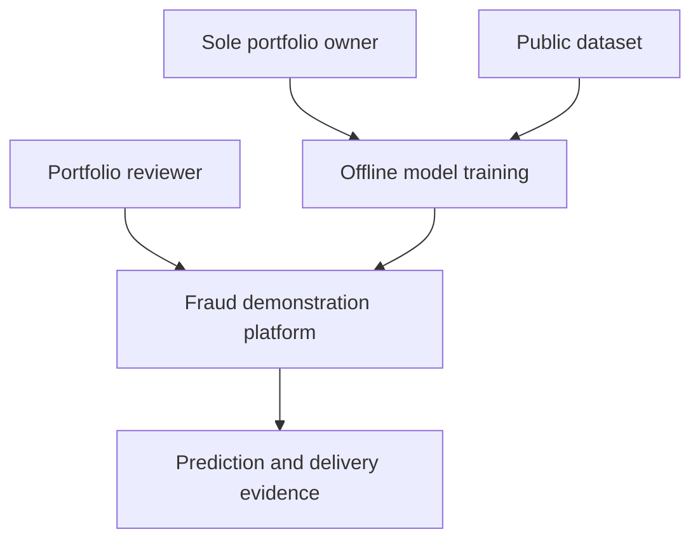
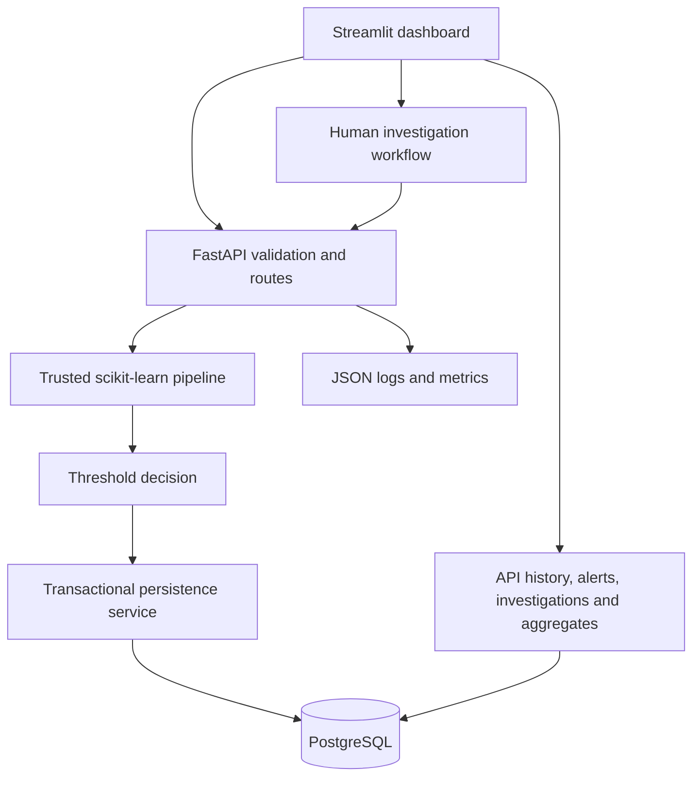
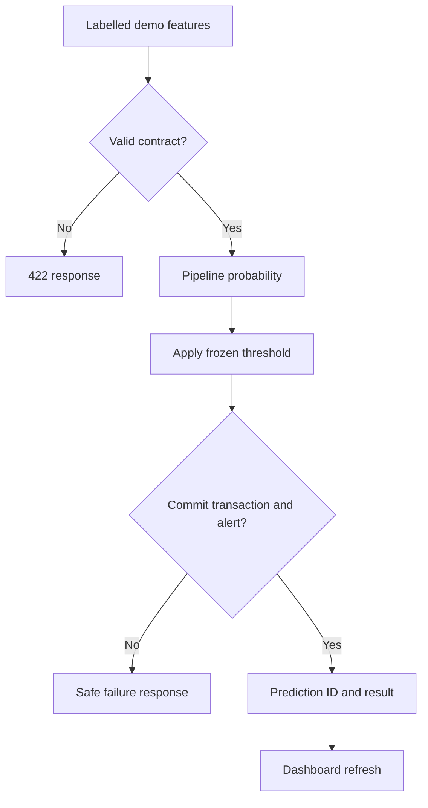
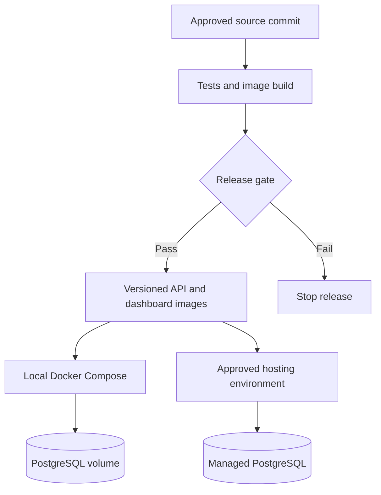

# Platform architecture
## System context

## Containers and components

## Request data flow

## Deployment proposal

Current implementation: health/readiness and validation, offline model training, API-to-model scoring, transactional PostgreSQL persistence, conditional alert creation, and the human investigation workflow are implemented and tested. The Streamlit dashboard consumes API-backed analytics, prediction history, alerts, and persisted investigations. The training pipeline runs offline and never executes inside a prediction request.

The implemented PostgreSQL schema is revision 3. It contains transactions, predictions, alerts, investigations, and investigation_notes. Each alert can have at most one investigation. Investigation notes are append-only. Closing an investigation records a controlled disposition (CONFIRMED_FRAUD, FALSE_POSITIVE, or INCONCLUSIVE) and resolves the associated alert atomically. Direct alert resolution is rejected while an investigation is active.

Investigation dispositions are human review outcomes in this portfolio proof-of-concept. They are not model labels and are not treated as independently established ground truth. Authentication, analyst identity, and assignment are not implemented in Phase 12 and are deferred to the authentication and RBAC phase.

Schema migrations are versioned and transactional, and application readiness requires the expected schema revision. Model metadata remains a versioned JSON manifest; a separate model registry service is unnecessary for this proof-of-concept.

Local Docker Compose deployment is implemented. Hosted deployment remains proposed and requires separate approval.
